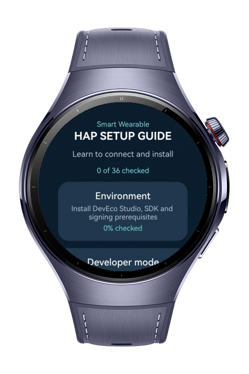
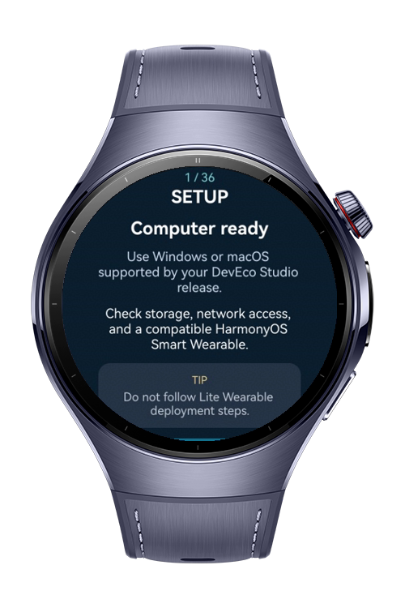
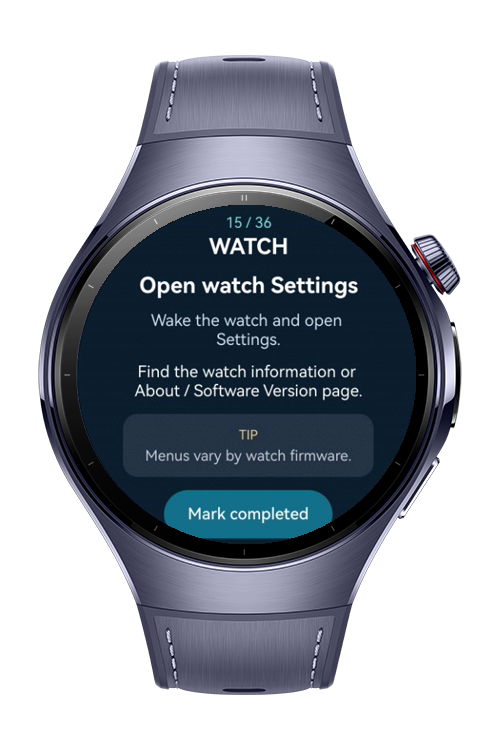
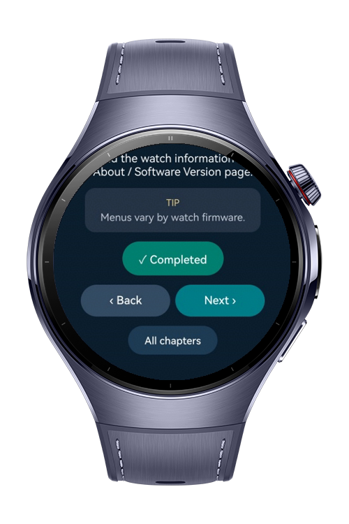

> **Note:** To access all shared projects, get information about environment setup, and view other guides, please visit [Explore-In-HMOS Index](https://github.com/Explore-In-HMOS/hmos-index).

# How to Install Debug HAP Files

**How to Install Debug HAP Files** demonstrates how to prepare Huawei Smart Wearable devices for HarmonyOS application development and
debugging. It provides a step-by-step guide to setting up the development environment, enabling Developer Options,
establishing an HDC connection, and installing `.hap` files on a physical Huawei Watch.

The application is developed using ArkTS and ArkUI with the MVVM architecture, offering an interactive guide with step
navigation and progress tracking.

# Preview

<div>
  
  
  
  
</div>

# Use Cases

- Configuring DevEco Studio and preparing the HarmonyOS development environment.
- Enabling Developer Options and HDC debugging on Huawei Smart Wearable devices.
- Connecting a Huawei Watch to DevEco Studio over Wi-Fi.
- Using HDC commands to retrieve device information and install `.hap` files.
- Following step-by-step instructions to deploy and debug HarmonyOS applications on physical wearable devices.

# Tech Stack

- **Language:** ArkTS
- **Framework:** HarmonyOS SDK (project-specific version)
- **Tools:** DevEco Studio, HDC (HarmonyOS Device Connector)
- **Architecture:** MVVM (Model-View-ViewModel)
- **Libraries:**
  - **ArkUI:** Used to build the interactive wearable user interface.
  - **Ability Kit:** Used for the application lifecycle and entry ability.

# Directory Structure

```text
entry/src/main/
├── ets/
│   ├── entryability/
│   │   └── EntryAbility.ets       # Application entry point
│   ├── model/
│   │   └── GuideModels.ets       # Guide chapters and step models
│   ├── pages/
│   │   └── Index.ets             # Main screen and navigation
│   ├── services/
│   │   └── GuideRules.ets        # Progress and completion calculations
│   ├── view/
│   │   ├── WatchHeader.ets       # Reusable watch header
│   │   ├── ChapterCard.ets       # Chapter selection component
│   │   ├── CommonCard.ets        # Reusable card component
│   │   └── StepCard.ets          # Step-by-step instruction component
│   └── viewmodel/
│       └── GuideViewModel.ets    # Navigation, state and progress logic
├── module.json5
```

# Constraints and Restrictions

## Supported Devices

- Huawei Watch 5

# License

**How to Install Debug HAP Files** is distributed under the terms of the MIT License. See the [LICENSE](LICENSE) for more information.
